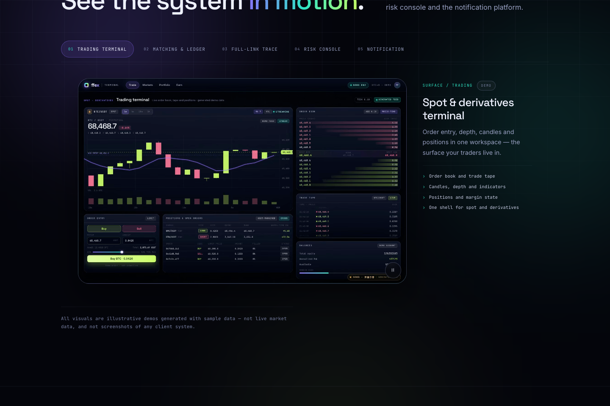
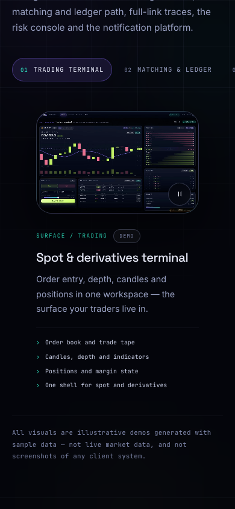

# ffex — exchange platform site

Buyer-facing site for the **ffex** digital-asset exchange platform. It presents
the two CEX implementations (Java and Go), the business and common capabilities,
full-link observability, and the ways to acquire the platform — source-code
licensing, direct delivery, joint build, custom modules and long-term support.

English is served at `/`, Chinese at `/zh/`. Built with a custom Hugo theme and
deployed to **GitHub Pages** by GitHub Actions on every push to `main`.

## Preview





The site is a marketing artefact: it publishes capability, design intent and
engagement models. This public repository contains **only the marketing site**.
No exchange platform source code, internal interfaces or configuration is
published here; source code is delivered under a signed licence and is never
published on the site. The site also contains no measured benchmarks, server
topology or client identities. See [Content rules](#content-rules) and
[`DESIGN.md`](DESIGN.md) for the block schema, visual system and acceptance
criteria.

## Stack

| Layer | Choice |
|---|---|
| Site generator | Hugo **0.168.0 extended** (pinned; the CI workflow verifies the release checksum) |
| Theme | Custom layouts in `layouts/`, styles and scripts in `assets/` — no external theme |
| Fonts | Self-hosted variable fonts in `static/fonts/` (SIL OFL; license files included) |
| Hosting | GitHub Pages via `.github/workflows/deploy.yml` |
| Demo reels | Dev-only Playwright + ffmpeg pipeline in `demo-src/`; output committed under `static/demo/` |

## Local development

Any Hugo 0.168.0 extended binary works. The team's local checkout keeps the
official release outside the repository, e.g.
`~/Library/Caches/ffex-tools/pkg/Payload/hugo` (extracted from the macOS `.pkg`
release; not committed).

```bash
cd ffex
HUGO=~/Library/Caches/ffex-tools/pkg/Payload/hugo   # or `hugo` on PATH
"$HUGO" server --port 1314 --bind 127.0.0.1          # http://127.0.0.1:1314/ffex/
"$HUGO" --gc --minify --destination /tmp/ffex-build  # production build
```

## Structure

```
content/en/  content/zh/       # bilingual pages (same paths, same translationKey)
  _index.md                    # home page blocks
  capabilities.md  stack.md  observability.md
  cooperation.md  about.md  contact.md
  posts/                       # Insights articles + section index
layouts/
  _default/                    # baseof, home, blocks, list, single, term, 404
  partials/blocks/             # one partial per content block type
  partials/                    # head, nav, footer, icons, visualisations
assets/css/  assets/js/        # concatenated, minified and fingerprinted by Hugo
i18n/                          # UI strings (en.toml / zh.toml)
static/
  brand/  favicon.svg          # logo mark
  demo/                        # animated demo reels (webm/mp4/jpg posters)
  og/                          # 1200x630 social cards
  fonts/                       # self-hosted woff2 + OFL licenses
demo-src/                      # dev-only scene sources and render script
DESIGN.md                      # design system, block schema, content rules
```

## Editing content

Pages are **block-based**: copy lives in YAML front matter, not in templates.
The complete field reference, page compositions and content rules are in
[`DESIGN.md`](DESIGN.md). In short:

- `layout: "blocks"` for regular pages; home is `_index.md` with the same
  `blocks:` list.
- Every block has a `type`; the matching partial is
  `layouts/partials/blocks/<type>.html`.
- English and Chinese pages share a `translationKey` and the same relative path
  so the language switch and `hreflang` work.
- Links inside block copy are language-relative site paths
  (`capabilities/`, `cooperation/`, `contact/`, `posts/` …). The `href` partial
  prefixes them with the current language.
- Never invent prices, measured performance figures, client names or internal
  identifiers. See [`DESIGN.md`](DESIGN.md) §7.

## Demo reels

The five animated interface demos (`terminal`, `matching`, `trace`, `admin`,
`notify`) and the OG cards are produced from the scene sources in `demo-src/`.
Tooling is dev-only and not required by the site build; see
[`demo-src/README.md`](demo-src/README.md) for the exact re-render commands.
Videos autoplay muted, pause off-screen, expose a pause control and fall back to
posters under `prefers-reduced-motion`.

## Content rules

Public and permanent. Do not add:

1. Platform source code, internal interface/RPC names, schemas or configuration.
2. Measured throughput/latency figures or real benchmark reports. Design intent
   only, no numbers that look measured.
3. Server topology, host counts, IPs, internal hostnames, credentials.
4. Client names, logos, testimonials or case studies.
5. Regulatory claims. The footer states that operating an exchange requires the
   operator's own licences and compliance.

All demo visuals must remain visibly labelled as illustrative. Contact channels
are `@bitdevops` (Telegram) and `horizonvideo@gmail.com`.

## Deployment

`.github/workflows/deploy.yml` builds the site with the checksum-verified Hugo
0.168.0 and publishes `public/` to Pages on pushes to `main`. `baseURL` is
derived from the Pages configuration, so forks and custom domains work without
editing `hugo.toml`. One-time Pages setup: repository **Settings → Pages →
Build and deployment → Source: GitHub Actions**.

## License

Site content and design © ffex. Fonts are distributed under the SIL Open Font
License (see `static/fonts/OFL-*.txt`). The platform itself is not distributed
through this repository.
